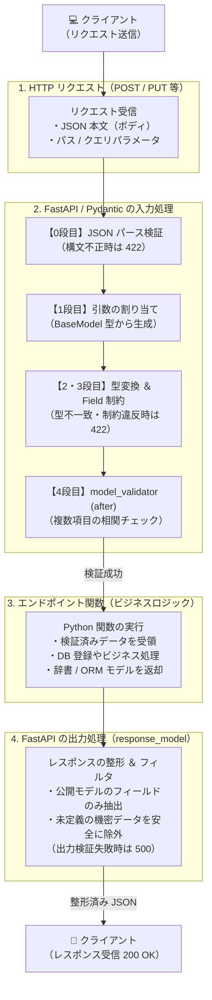
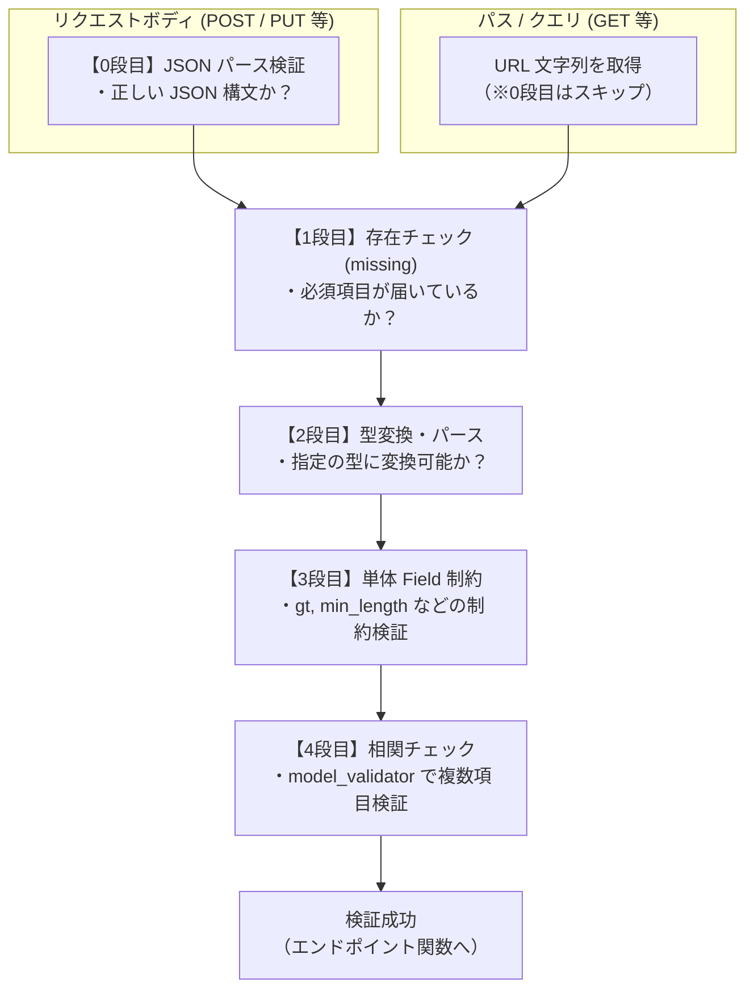

# 04. Pydantic v2：リクエストボディとレスポンスモデルの完全理解

FastAPI における **Pydantic スキーマ（入力検証・出力制御・スキーマ設計）** についての学習記録と重要ポイントのまとめです。

---

本章では主に **リクエストボディを受け取るエンドポイント（POST / PUT / PATCH 等）** を中心に、FastAPI と Pydantic がどのように連携してデータを処理するかを扱います。



---

## 2. リクエストボディの受け取りと入力検証

### ① パス / クエリ / ボディ の自動判別ルール
FastAPI は関数の引数の**型注釈**を見て、どこからデータを取得するかを自動判別します。

| 引数の型注釈 | 取得元 | 判定理由 |
| :--- | :--- | :--- |
| `item_id: int` | **パス** または **クエリ** | プリミティブ型（パス定義 `{item_id}` にあればパス、無ければクエリ） |
| `item: ItemCreate` | **リクエストボディ** | `BaseModel` を継承したクラス型であるため |

### ② 入力検証のステップ（Path / Query / Body の違いと前提）

FastAPI は、リクエストに含まれる **パスパラメータ**・**クエリパラメータ**・**リクエストボディ** をそれぞれ検証します。

特に **POST / PUT / PATCH などでリクエストボディ（JSON）を受け取る場合** は、以下の「0段目」を含む 4 段階の検証が順に実行されます。



#### 各ステップの詳細とエラー例

1. **[0段目] JSON パース（※ リクエストボディのみ）**:
   - **内容**: 送られてきた本文が JSON として正しく解釈できるか。
   - **失敗例**: `"price": abc`（クォート忘れ）、末尾の余分なカンマ。
   - **エラー**: `type: "json_invalid"`, `loc: ["body", 34]`（※ まだフィールドを特定できないため、2つ目の要素は「34文字目」という文字位置の数字になる）。
2. **[1段目] 存在チェック（共通）**:
   - **内容**: デフォルト値のない必須パラメータが届いているか。
   - **エラー**: `type: "missing"`（※ `loc` は `["body", "name"]` や `["query", "limit"]` となる。ボディの場合、`input` には親オブジェクト全体が入る）。
3. **[2段目] 型変換・パース（共通）**:
   - **内容**: 指定した型（`int`, `float`, `bool` など）に変換できるか。
   - **エラー**: `type: "float_parsing"` など（※ `input` には問題のあった値 `"abc"` そのものが入る）。
4. **[3段目] 単体制約チェック（共通）**:
   - **内容**: `Field(...)`, `Path(...)`, `Query(...)` に設定した `gt`（より大きい）や `min_length` を満たすか。
   - **エラー**: `type: "greater_than"`, `type: "string_too_short"` など。

> **`loc` の共通ルール**:  
> エラー発生場所を示す `loc` の先頭には `["body", ...]` / `["query", ...]` / `["path", ...]` が入り、どこから来た値のエラーかが一目で分かります。

> **ポイント：エラーは1件目で打ち切られず、リストにまとめて返される**  
> `routing.py` の内部で検証エラーを配列に蓄積してから `RequestValidationError` (422) を投げるため、フォーム送信時などに複数エラーを一度にフロントへ通知できます。

---

## 3. スキーマの検証テクニック（Field / Validator / Config）

### ① 単体フィールドの制約：`Field`
`Path` や `Query` と同様の制約（`gt`, `ge`, `min_length` など）をクラス内のフィールドに指定します。

```python
from pydantic import BaseModel, Field

class ItemCreate(BaseModel):
    name: str = Field(min_length=1, max_length=50)
    price: float = Field(default=10.0, gt=0)  # default はキーワード引数で書く（型推論のため）
```

> **内部構造のメモ**:  
> `Path` や `Query` は `fastapi.params.Param` を経由して Pydantic の `FieldInfo` を継承しています。そのため、`gt` や `min_length` などの引数名や内部メタデータは `Field` と全く同じです。

### ② 複数フィールドにまたがる相関チェック：`@model_validator(mode="after")`
「`sale_price` は `price` より安くなければならない」のような、**複数項目を見比べるチェック**には `model_validator` を使います。

```python
from pydantic import BaseModel, model_validator

class ItemCreate(BaseModel):
    name: str
    price: float
    sale_price: float | None = None

    @model_validator(mode="after")
    def check_sale_price(self):
        # mode="after" なので、各フィールドの型変換・Field制約を通過した「self」を受け取れる
        if self.sale_price is not None and self.sale_price >= self.price:
            raise ValueError("sale_price must be lower than price")
        return self
```

- **`mode="after"`**: 全項目の型変換と `Field` 検証が完了し、インスタンスが生成された後に実行される（安全に `self.field` を扱えるため基本はこちらを使う）。
- **`mode="before"`**: パース前の生データ（`dict`）を受け取る。カンマ区切りの文字列 `"1,980"` を数値に前処理したい場合などに使用。
- **例外**: 標準の `ValueError` を `raise` すると、Pydantic が自動で 422 検証エラーに変換してくれる。

### ③ 想定外のフィールドの混入を防ぐ：`model_config`
クライアントがキー名をスペルミス（例: `sale_price` を `salePrice`）して送った場合、デフォルト（`extra="ignore"`）では**黙って無視**されてしまいます。ミスを確実に弾くには `extra="forbid"` を設定します。

```python
from pydantic import BaseModel, ConfigDict

class ItemCreate(BaseModel):
    name: str
    price: float

    model_config = ConfigDict(extra="forbid")  # 定義されていないキーが来たら 422 エラー
```

---

## 4. レスポンスの制御：`response_model`

### ① 安全な出力フィルタリング
エンドポイントに `response_model` を指定すると、関数が返したデータから**定義されたフィールドのみを抽出**してレスポンスを組み立てます。

```python
@app.post("/items", response_model=ItemPublic)
def create_item(item: ItemCreate):
    # DBのレコードや社内用メモを含む辞書を返しても……
    return {
        "id": 1,
        "name": item.name,
        "price": item.price,
        "secret_memo": "社内機密情報",  # ItemPublic に無ければクライアントには返らない！
    }
```

- **漏洩防止の防壁**: DBモデルや内部データをそのまま return しても、`ItemPublic` に定義のない列は外に出ません。
- **500 エラー**: 出力側の検証に失敗した場合はクライアントの責任ではないため、422 ではなく **500 Internal Server Error**（`ResponseValidationError`）になります。

### ② 宣言方法の2つの書き方（`-> ItemPublic` vs `response_model=`）

出力スキーマを宣言する方法には **「関数の戻り値型注釈」** と **「デコレータ引数」** の2通りがあります。

```python
# パターン A: 戻り値の型注釈（公式推奨）
@app.get("/items/{item_id}")
def get_item(item_id: int) -> ItemPublic:
    ...

# パターン B: デコレータの引数指定
@app.get("/items/{item_id}", response_model=ItemPublic)
def get_item(item_id: int):
    ...
```

#### FastAPI としての機能は「完全に同じ」
どちらの書き方をしても、FastAPI の内部では全く同じ処理が行われます。
1. **不要データの除外**: 定義外のフィールド（`secret_memo` 等）の安全な削ぎ落とし
2. **データの型変換・検証**: 出力データのシリアライズ（失敗時は 500 エラー）
3. **Swagger UI への反映**: `/docs` のレスポンススキーマへの `ItemPublic` の反映

#### 違いは「Python（型チェッカー・エディタ）にどう伝わるか」

| 宣言方法 | 伝える相手 | メリット | 注意点（不便な点） |
| :--- | :--- | :--- | :--- |
| **パターン A**<br>`-> ItemPublic`<br>（公式推奨） | **FastAPI** と **型チェッカー**（Pylance/MyPy）の両方 | エディタのコード補完が効き、OpenAPI も自動生成される。 | 関数内で ORM モデル（`Item`）や `dict` をそのまま return すると、**型チェッカーに「型不一致」と怒られる**（手動で `ItemPublic.model_validate(db_item)` などが必要）。 |
| **パターン B**<br>`response_model=ItemPublic` | **FastAPI だけ** | 関数から `dict` や ORM モデルを返しても型チェッカーに怒られない。 | Python の型チェッカーには戻り値の型情報が伝わらない（`Any` 扱い）。 |
| **⭐ ベストプラクティス**<br>`response_model=ItemPublic` ＋ `-> Item` (ORM型) | **FastAPI** と **型チェッカー** の両方に正確な役割分担 | **型チェッカーは ORM の返却として完全検証**され、**FastAPI は `ItemPublic` で安全に出力変換・OpenAPI 生成**を行う。実務で最も安全かつ快適な書き方。 | デコレータ引数と型注釈の両方を書く必要がある。 |

#### どう使い分けるべきか？
- **DB (ORM) を使ってオブジェクトをそのまま返す場合（実務の王道）**:  
  ```python
  @app.get("/items/{item_id}", response_model=ItemPublic)
  def get_item(item_id: int) -> Item:  # Item は SQLAlchemy などの ORM クラス
      db_item = db.query(Item).filter(Item.id == item_id).first()
      return db_item  # 型チェッカーも FastAPI も完璧に動作する！
  ```
  ※ `ItemPublic` には `model_config = ConfigDict(from_attributes=True)` が必要です。
- **Pydantic モデルに手動変換して返す場合**:  
  `return ItemPublic.model_validate(db_item)` と書くなら、`def get_item(...) -> ItemPublic:` で OK。
- **辞書（`dict`）を手動で組み立てて返す場合**:  
  `@app.get(..., response_model=ItemPublic)` で `def get_item(...) -> dict:` または型注釈省略。

※ 両方同時に書いた場合は、FastAPI のスキーマ・シリアライズには `response_model=` の指定が優先されます。

---

## 5. 実践的なスキーマ設計（入力用・出力用・更新用の描き分け）

用途ごとにスキーマを分離するのが FastAPI / Pydantic のベストプラクティスです。

### ① スキーマを分ける理由
```
                  name    price     id     secret_memo
Create（登録）    必須    必須      × (不要)     ○ (任意入力)
Update（更新）    任意    任意      × (不要)     ○ (任意入力)
Public（出力）    ○       ○         ○ (必須)     × (漏洩防止で除外)
DB テーブル       ○       ○         ○ (主キー)   ○ (保存)
```
- **新規登録（Create）**: `id` は DB が自動採番するため入力には含めない。
- **一部更新（Update）**: 変更したい項目だけ送るため、全フィールドを `None` 許容（任意）にする。
- **出力（Public）**: 採番された `id` を含め、社内用の `secret_memo` を除外する。

### ② 継承を使った設計パターン
```python
from pydantic import BaseModel, ConfigDict, Field, model_validator

# 共通基底クラス（バリデーションや設定を一括定義）
class ItemBase(BaseModel):
    name: str = Field(min_length=1, max_length=50)
    price: float = Field(gt=0)
    model_config = ConfigDict(extra="forbid")

# 1. 登録用（Base をそのまま継承）
class ItemCreate(ItemBase):
    secret_memo: str | None = None

# 2. 出力用（id を追加）
class ItemPublic(ItemBase):
    id: int

# 3. 更新用（全フィールドを任意にするため個別定義）
class ItemUpdate(BaseModel):
    name: str | None = Field(default=None, min_length=1, max_length=50)
    price: float | None = Field(default=None, gt=0)
    sale_price: float | None = Field(default=None, gt=0)
    secret_memo: str | None = None
    model_config = ConfigDict(extra="forbid")

    @model_validator(mode="after")
    def check_at_least_one_field_and_price(self):
        # 何も更新対象が送られてこなかったら弾く
        if not self.model_fields_set:
            raise ValueError("At least one field must be provided for update")
        
        # 値が存在する場合のみ相関チェック（None >= 数値 の TypeError を防ぐ）
        if self.price is not None and self.sale_price is not None:
            if self.sale_price >= self.price:
                raise ValueError("sale_price must be lower than price")
        return self
```

---

## 6. 実装時の重要ポイント・落とし穴（Tips）

### ① PATCH 更新時の「未送信」と「明示的な null」の区別
- `{}`（変更なし）と `{"sale_price": null}`（セール解除）は、Python 上ではどちらも `item.sale_price is None` になります。
- これを正しく区別して更新するには、`item.model_dump(exclude_unset=True)` を使います。
  - `model_fields_set`: 実際にリクエストに含まれていたフィールド名の集合。
  - `exclude_unset=True`: 送られてこなかったフィールドを除外して辞書化する。

```python
# 送られてきた項目だけを安全に DB レコードへ反映する
update_data = item.model_dump(exclude_unset=True)
for key, value in update_data.items():
    setattr(db_item, key, value)
```

### ② `/docs`（Swagger UI）の正しい読み方
- **`Request body`**: リクエスト送信用の入力欄。
- **`Server response`（単数）**: 「Execute」実行後に**実際にサーバーから返ってきた結果**。
- **`Responses`（複数）**: 返り得る HTTP ステータスコードと**スキーマ定義（仕様書）**。実行前から表示されている。
- **`{"additionalProp1": {}}` の表示**:
  - 関数の戻り値が `-> dict` などの汎用型になっていると表示される。
  - `response_model=ItemPublic` などを正しく指定すると、具体的なスキーマ構造が表示されるようになる。

### ③ Pydantic と TypeScript (Zod) の設計思想の違い
- **Zod**: スキーマが「値（オブジェクト）」なので、`ItemBase.partial()` や `.omit()` などの関数合成・派生が手軽に行える。
- **Pydantic**: スキーマが「クラス」として定義されるため、派生スキーマを作る際はクラス継承や再定義が必要になる。その代わり、Python 標準の型ヒントやエディタの静的解析（Pylance 等）と自然に統合されるメリットがある。
