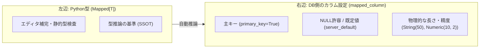

# SQLAlchemy 2.0 のカラム定義・型推論・実行時エラー

SQLAlchemy 2.0 におけるカラム定義の型情報の役割、型推論の仕組み、および実行時における型検証・エラーの発生タイミングについてのまとめ。

---

## 1. カラム定義における左辺と右辺の役割

SQLAlchemy 2.0 では、左辺の Python 型注釈を **SSOT（信頼できる唯一の情報源）** として扱い、右辺には Python 型だけでは表現できない DB の物理制約のみを記述する。



### 役割分担

| 記述箇所 | 役割 | 主な指定項目 |
|---|---|---|
| 左辺 (`Mapped[T]`) | Python 側の型注釈・型推論の入力 | 型（`int`, `str`, `datetime` 等）、NULL 許容（`T | None`） |
| 右辺 (`mapped_column()`) | DB スキーマ定義・物理制約 | `primary_key`, `ForeignKey`, `unique`, `server_default`, 物理型指定 |

- **基本原則**: 右辺の型指定は原則省略し、左辺の型から自動推論させる。
- **右辺に型を書くケース**: 文字数制限（`String(50)`）や小数の精度（`Numeric(10, 2)`）、特定の DB 型（`BigInteger`）など、Python の型表現を超える物理制約が必要な場合のみ指定する。

---

## 2. 型推論の仕組みと集約（`Annotated` + `type_annotation_map`）

### 推論の解決順序

1. `Mapped[X]` から `Optional` / `| None` を剥がして基本型を取り出す（`| None` があれば nullable=True、なければ NOT NULL）。
2. `Base` クラスに定義された `type_annotation_map`（カスタム対応表）を検索する。
3. なければ SQLAlchemy デフォルトの対応表（`int` → `Integer`, `str` → `String` 等）で解決する。
4. ※ 右辺の `mapped_column(Type)` で型が明示された場合は、右辺が優先される。

### 型定義の集約

プロジェクト全体で共通する制約（例: 50文字の文字列、タイムゾーン付き日時）は、`Annotated` と `type_annotation_map` で集約する。

```python
from datetime import datetime
from typing import Annotated
from sqlalchemy import String, TIMESTAMP, func
from sqlalchemy.orm import DeclarativeBase, Mapped, mapped_column

str50 = Annotated[str, 50]

class Base(DeclarativeBase):
    type_annotation_map = {
        str50: String(50),
        datetime: TIMESTAMP(timezone=True),
    }

class User(Base):
    __tablename__ = "users"

    id: Mapped[int] = mapped_column(primary_key=True)
    name: Mapped[str50]                  # VARCHAR(50) NOT NULL
    email: Mapped[str50 | None]          # VARCHAR(50) NULL
    created_at: Mapped[datetime] = mapped_column(server_default=func.now())
```

---

## 3. 実行時の型検証とエラー発生の仕組み

### 代入時は検証されない

Python の型注釈は実行時には強制力を持たず、モデル属性への代入時点ではエラーにならない。
上の `User` で言えば、`created_at` は `Mapped[datetime]` と宣言されているが、

```python
user.created_at = "2020-01-01"   # 文字列。ここでは何も起きない
```

と代入しても、この行は素通りする。型変換が実行されるのは、**`flush()`（`commit()` を含む SQL 発行時）** のタイミングとなる。

### エラーの種類と発生場所

`commit()` を呼んでから DB に行が書き込まれるまでには、3人の登場人物が順に仕事をする。
エラーはそれぞれの段階で別の名前で出るため、例外名を見ればどこで失敗したかが分かる。
以下は Postgres（ドライバは psycopg）を使った場合の流れ。

```text
[属性代入: user.created_at = "2020-01-01"]
      │ (代入時は素通り。Python は注釈をチェックしない)
      ▼
session.commit()
      │
┌─────┴───────────────────────────────────────────────────┐
│ ① SQLAlchemy（まだ Python の中。通信していない）          │
│                                                          │
│  1. 変更されたオブジェクトを調べる                        │
│     セッションが預かっているオブジェクトを全部見て、       │
│     新しく作られた／書き換えられた／消されたものを拾い、   │
│     どの行を INSERT / UPDATE / DELETE するか決める        │
│                                                          │
│  2. SQL 文を組み立てる                                    │
│     "INSERT INTO users (created_at) VALUES (%(created_at)s)"
│     値が入る位置には %(created_at)s という目印を書く。     │
│     実際の値は SQL 文の中に現れず、別の入れ物に取っておく  │
│                                                          │
│  3. bind_processor                                       │
│     取っておいた値を、psycopg が受け取れる形に直す        │
│     直せなかった場合 ──> StatementError                   │
│                                                          │
│  4. SQL 文と値を psycopg に渡す                           │
└─────┬───────────────────────────────────────────────────┘
┌─────┴───────────────────────────────────────────────────┐
│ ② psycopg（Postgres と通信する部品）                     │
│                                                          │
│  5. 目印の書き方を Postgres の書き方に直す                │
│     %(created_at)s ──> $1                                │
│                                                          │
│  6. 値を Postgres が読める形に変換する                    │
│     Postgres は Python のオブジェクトを知らないので、     │
│     ネットワークで送れるデータの並びに直す                │
│     変換方法が用意されていない型 ──> ProgrammingError     │
│                                                          │
│  7. SQL 文と値を、別々に送信する                          │
└─────┬───────────────────────────────────────────────────┘
┌─────┴───────────────────────────────────────────────────┐
│ ③ PostgreSQL サーバ                                      │
│                                                          │
│  8. SQL 文だけを先に受け取り、解析する                    │
│  9. 次に値を受け取り、$1 の位置に入れる                   │
│     入れた値が列の型に合わない ──> DataError              │
│ 10. 実行する。NOT NULL / UNIQUE / FK / CHECK 違反         │
│                                 ──> IntegrityError       │
│ 11. COMMIT                                               │
└──────────────────────────────────────────────────────────┘
```

| 例外の種類 | 出る場所 | 主な原因 |
|---|---|---|
| `StatementError` | ① SQLAlchemy（Python 側） | `bind_processor` での変換失敗（`ValueError` / `TypeError` をラップする） |
| `ProgrammingError` | ② psycopg（Python 側） | その Python 型を Postgres 用に変換する方法が用意されていない |
| `DataError` | ③ DB サーバ | 届いた値が列の型に合わない |
| `IntegrityError` | ③ DB サーバ | 制約違反（NOT NULL、主キー/ユニーク重複、外部キー、CHECK） |

※ 型の取り違え自体は `IntegrityError` ではなく、`StatementError` / `ProgrammingError` / `DataError` のいずれかになる。

### `bind_processor` が何をするか（DB によって違う）

3番の `bind_processor` は「Python の値を、ドライバが受け取れる形に直す」担当だが、
**何をするかは DB ごとに違う。**

- **SQLite**: `datetime(2020, 1, 1)` はそのままでは保存できないので、
  ここで `"2020-01-01 00:00:00"` という文字列に直す。
- **Postgres**: psycopg が `datetime` をそのまま扱えるので、SQLAlchemy 側で直す必要がない。
  そのため `datetime` 用の変換処理が**登録されておらず**、この段階は素通りする。

実際に確認したところ（`backend/` で `uv run python` を実行）、Postgres では
`Integer` / `String` / `DateTime` はいずれも変換処理を持たず（`bind_processor` が `None`）、
`Numeric` と `Boolean` だけが処理を持っていた。SQLite ではこれに `DateTime` が加わる。

**同じコードでも、変換が起きる場所とエラーの出る場所が DB によって変わる**、ということになる。

### 型の不一致が最後まで素通りする場合もある

上記とは別に、**そもそもどこでもエラーにならない**ケースがある。
`Mapped[int]` の列に `"abc"` を代入して SQLite に `commit()` すると、
例外は出ず、`"abc"` がそのまま保存される（同じく `uv run python` で確認）。

理由は2つ。`Integer` は SQLite でも Postgres でも `bind_processor` を持たない（①で素通りする）。
そして SQLite は列の型と違う値を受け入れる作りになっている（③でも弾かれない）。

つまり「`flush()` で型が検証される」は全ての型に当てはまるわけではない。
確実に弾きたい値は、`@validates` か DB の CHECK 制約で明示的に止める必要がある。
